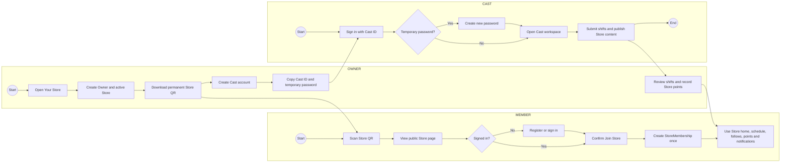

# CastFan Multi-Store Scope

This document records the 12 November 2026 scope expansion and is the focused source of truth for Store onboarding and isolation.

## Product Vision

CastFan is a mobile-first platform for independent venues that employ Cast staff. An Owner can open one Store, publish its permanent QR, create Store-specific Cast accounts, and manage schedules, content, events, promotions, and Member points. A Member keeps one CastFan account across Stores while every Store relationship, balance, tier, follow, preference, notification, and history remains isolated.

## Business Workflow

## Sitemap

- `/login` — Email or Cast ID sign-in.
- `/signup` — global Member registration.
- `/signup/store` — Owner and Store registration in one transaction.
- `/s/{slug}` — public Store landing page and POST-only Member join.
- `/account/stores` — Member's joined Stores; QR guidance when empty.
- `/s/{slug}/home`, `/schedule`, `/casts`, `/following`, `/membership`, `/notifications` — Store-scoped Member experience.
- `/owner/store/settings` — editable Store name, description, and address; immutable slug.
- `/owner/store/qr` — view or download permanent Store QR.
- `/owner/cast` — create, reset, activate, or deactivate Store-specific Cast accounts.
- `/account/change-password` — mandatory first-login Cast password replacement.

## Functional Requirements

- **FR-20 Owner Store Registration and Setup:** a visitor creates one Owner account and one active Store atomically. Owner and slug uniqueness are enforced by the database and service.
- **FR-21 QR Store Access and Automatic Membership:** `/s/{slug}` resolves only an active Store. Joining is a CSRF-protected POST. Login from a verified Store context creates one idempotent StoreMembership.
- **FR-22 Owner-Created Cast Account:** only the Store Owner creates Cast accounts. The immutable Cast ID is unique, a temporary password is shown once, and first login requires password replacement.
- **FR-23 Store Data Isolation:** all Member points, tier, following, notifications, content, schedules, events, promotions, and Owner actions are evaluated against the authenticated or slug-resolved Store.

## Data Isolation Rules

- Never accept a client Store, Owner, Cast, or Member identifier as authorization evidence.
- Owner and Cast Store context comes from the authenticated account.
- Member and public Store context comes from a validated active slug.
- `(store_id, member_profile_id)` is unique.
- Receipt references are unique per Store, not globally.
- A Cast profile and its content belong to exactly one Store.
- Cross-Store point adjustments, password resets, follows, content reads, shifts, events, and promotions must fail as not found or access denied.

## Non-Functional Requirements

1. **Performance:** common Store pages and Store-scoped list queries must use bounded result sets and indexed Store keys, and should complete within two seconds under the course demonstration workload.
2. **Responsive usability:** Store signup, QR landing, My Stores, Owner roster, and first-login password change must remain usable without horizontal scrolling at 320 px and at desktop width.

## Migration

Flyway V12 preserves the existing CastFan data as the `castfan` Store, creates StoreMembership records from existing Member data, migrates point history and following relationships, adds Store scope to Cast profiles and content, and derives login identifiers from existing emails. Production migration requires a current Cloud SQL export and a successful disposable-MySQL rehearsal.
